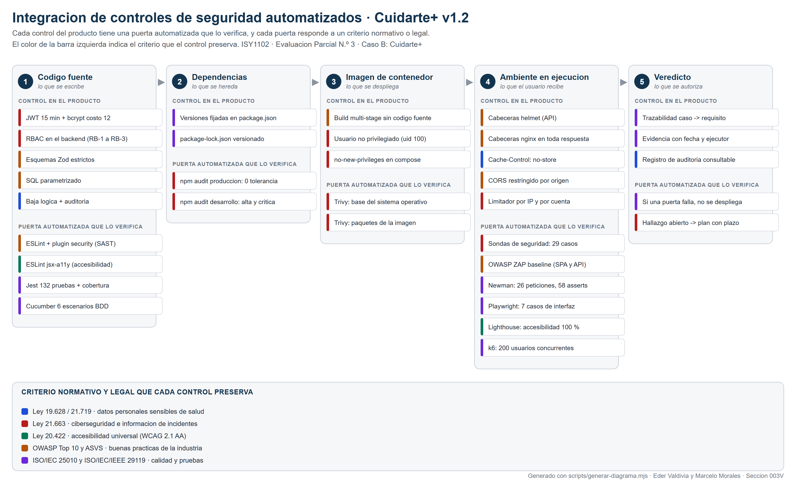

# EP3 — Cuidarte+ · Evaluación Parcial N.º 3 (ISY1102)

Entregables de la **Evaluación Parcial N.º 3** de *Seguridad y Calidad en el
Desarrollo de Software*, sobre el **Caso B: Cuidarte+** (sistema de exámenes
médicos).

**Eder Valdivia · Marcelo Morales** · Sección 003V · Docente: Mauricio Andrés
Velásquez Silva · 23 de noviembre de 2026

[](https://github.com/EderDev138/seguridad-calidad-software-ev3-cuidarte/actions/workflows/calidad-y-seguridad-ep3.yml)

El badge corresponde a las cuatro etapas de puertas automatizadas que se
ejecutan en cada cambio: código fuente, dependencias, imágenes de contenedor y
ambiente en ejecución. Las tres últimas incluyen las puertas que la EP2
declaraba y nunca ejecutaba —Trivy, OWASP ZAP y las sondas dirigidas—, que son
las que detectaron cinco de los seis defectos de esta evaluación.

Esta fase aplica sobre la versión corregida de la EP2 cinco enfoques de pruebas
de seguridad y cuatro herramientas de automatización que el proyecto **no había
ejecutado nunca**, aunque tres de ellas estaban declaradas en su pipeline desde
octubre. Aparecieron seis defectos reales, cuatro graves. Están todos cerrados y
verificados.

---

## 1. Qué se entrega

| Ruta | Contenido |
|---|---|
| `entrega/Informe_EP3_Cuidarte+.docx` | **Informe del encargo** (grupal, 11 %), con el formato de la pauta |
| `docs/06_Informe_EP3_Cuidarte+.md` | Fuente de verdad del informe; el `.docx` se genera desde aquí |
| `docs/05_Guion_Oral_EP3.md` | Guion de la **defensa individual** (24 %) y banco de preguntas |
| `docs/00_Comparacion_EV2_y_ejemplo_Atlas.md` | Análisis de brechas que originó este trabajo |
| `docs/01_Plan_de_pasos_EP3.md` | Plan de trabajo ordenado por los pesos de la rúbrica |
| `docs/02_Ajustes_EP1_EP2.md` | Ajustes según la retroalimentación y los pendientes de la EP2 |
| `docs/03_Diagrama_controles.md` | Lectura del diagrama de controles (IE3 / IE4) |
| `docs/04_Mitigacion_y_mantenimiento.md` | Mitigación de los seis defectos y plan de mantenimiento |
| `docs/07_Paso_a_Paso_Reproducir_EP3.md` | Cómo reproducir cada cifra, con lista de verificación final |
| `docs/08_Demo_End_to_End.md` | **Guion de la demostración**: levantar, probar y mostrar, con tiempos y plan B |
| `codigo/cuidarte-plus-v1.2/` | Software bajo prueba, derivado de la v1.1 de la EP2 |
| `seguridad/` | Batería de pruebas de seguridad (sondas, ZAP, Trivy, SAST, SCA) |
| `automatizacion/` | Batería de automatización (Playwright, Postman, Lighthouse, k6) |
| `scripts/` | Generadores del diagrama y del informe en Word |
| `.github/workflows/` | Puertas automatizadas de calidad y seguridad (§5.2 del informe) |
| `evidencias/v1.2/` | Anexos de cada ejecución, en versión `ANTES` y `DESPUES` |

---

## 2. Resultado de la evaluación

### Seis defectos detectados, seis cerrados

| ID | Defecto | Criticidad | Detectado por |
|---|---|---|---|
| INC-EP3-01 | Los archivos estáticos de la SPA se servían **sin ninguna cabecera de seguridad** | Grave | Sonda SEG-D2 y OWASP ZAP |
| INC-EP3-02 | Toda petición con `Origin` no permitido devolvía **HTTP 500** | Grave | Sonda SEG-C7 |
| INC-EP3-03 | Tres dependencias de producción con avisos nuevos | Grave | `npm audit` |
| INC-EP3-04 | Imagen de la SPA con base sin parches: **1 crítica y 57 altas** | Grave | Trivy |
| INC-EP3-05 | Datos clínicos almacenables en caché; sin aislamiento de origen | Moderado | OWASP ZAP |
| INC-EP3-06 | `npm` viajaba a la imagen de producción, con 6 altas | Moderado | Trivy |

Ninguno fue detectado por las 132 pruebas unitarias ni por los 6 escenarios BDD
heredados de la EP2. No es una falla de esa batería: verifica el comportamiento
del dominio, y estos defectos viven en la configuración, en las dependencias y
en la imagen de contenedor.

### Antes y después

| Medida | Antes | Después |
|---|---|---|
| Sondas de seguridad | 27 de 29 | **29 de 29** |
| OWASP ZAP sobre la SPA | 2 fallos · 64 reglas aprobadas | **0 fallos · 67 aprobadas** |
| `npm audit` producción | 3 avisos (2 altas) | **0** |
| Trivy · imagen de la SPA | 239 (1 crítica, 57 altas) | **1 (0 altas)** |
| Trivy · imagen de la API | 33 (8 altas) | **11 (0 altas)** |
| Pruebas Jest · escenarios BDD | 132 de 132 · 6 de 6 | **132 de 132 · 6 de 6** |

### Automatización incorporada

| Herramienta | Alcance | Resultado | Duración |
|---|---|---|---|
| Playwright | 7 casos de interfaz trazados al ERS | 7 de 7 | **8,4 s** |
| Postman + Newman | 26 peticiones, 58 aserciones | 58 de 58 | **4,3 s** |
| Lighthouse | Rendimiento, accesibilidad, buenas prácticas | **100 / 100 / 100** | 15,4 s |
| k6 | 200 usuarios concurrentes | 7.414 iteraciones · 0,00 % error | 46,0 s |

Los siete casos de interfaz que corren en 8,4 segundos equivalen a unos 10
minutos de operación manual: una reducción del 98,7 %. Pero el argumento de
fondo no es el ahorro de tiempo, sino la **frecuencia**: una prueba manual de
diez minutos se ejecuta una vez y se abandona; una de nueve segundos se ejecuta
en cada cambio.

---

## 3. Arranque rápido

```bash
cd codigo/cuidarte-plus-v1.2
cp .env.example .env          # completar los tres secretos
docker compose up -d --build
docker compose --profile semilla run --rm semilla
```

| Recurso | URL |
|---|---|
| SPA | http://localhost:5173 |
| API | http://localhost:3000/api/v1 |
| Healthcheck | http://localhost:3000/api/v1/salud |

Usuarios de prueba, contraseña común `Cuidarte2026!`: `admin1`, `medico1`,
`medico2`, `paciente1`, `paciente2`. Esa credencial es pública a propósito y
válida **solo** en el ambiente QA local.

### Ejecutar las dos baterías

```bash
cd automatizacion && npm install && npx playwright install chromium
EJECUTOR="Su Nombre" bash ejecutar-automatizacion.sh      # ~3 min

cd ../seguridad
EJECUTOR="Su Nombre" bash ejecutar-seguridad.sh           # ~6 min
```

### Regenerar diagrama e informe

```bash
cd scripts && npm install
node generar-diagrama.mjs       # evidencias/v1.2/capturas/diagrama_controles.png
node generar-informe-docx.mjs   # entrega/Informe_EP3_Cuidarte+.docx
```

El procedimiento detallado, con los resultados esperados de cada paso y qué
hacer cuando algo falla, está en
[`docs/07_Paso_a_Paso_Reproducir_EP3.md`](docs/07_Paso_a_Paso_Reproducir_EP3.md).

Para el día de la evaluación —qué escribir, en qué orden, cuánto tarda cada
cosa y qué hacer si algo falla en vivo— use
[`docs/08_Demo_End_to_End.md`](docs/08_Demo_End_to_End.md). La demostración
completa son tres comandos y veinte segundos.

---

## 4. Las dos baterías

### `seguridad/` — cinco enfoques

| Archivo | Qué hace |
|---|---|
| `ejecutar-seguridad.sh` | Lanza la batería completa y guarda cada anexo con su encabezado |
| `sondas-seguridad.mjs` | 29 sondas dirigidas: autenticación, control de acceso, validación de entradas, configuración |
| `desbloquear-usuarios.sh` | Reinicia el bloqueo por intentos fallidos para poder repetir la batería |
| `zap/rules.tsv` | Reglas del escaneo de OWASP ZAP, trazadas a requisitos del ERS |

Las herramientas externas —OWASP ZAP, Trivy— se ejecutan en contenedor, sin
instalar nada en el equipo.

### `automatizacion/` — cuatro herramientas

| Archivo | Qué hace |
|---|---|
| `ejecutar-automatizacion.sh` | Lanza la batería completa en el orden correcto |
| `ui-flujo-playwright.mjs` | 7 casos de interfaz en un navegador real, con capturas |
| `postman/` | Colección y ambiente de Postman, ejecutables con Newman |
| `lighthouse-spa.mjs` | Auditoría no funcional con umbrales declarados |
| `carga-k6.mjs` y `carga-k6.js` | Carga de 200 usuarios con los umbrales del ERS |

---

## 5. Diagrama de controles



Cinco etapas, de lo que se escribe a lo que se autoriza. En cada una, el control
que protege el producto y la puerta automatizada que lo verifica. El color
indica qué ley o estándar preserva ese control.

La lectura completa, con la tabla de trazabilidad y cómo explicarlo en la
defensa, está en [`docs/03_Diagrama_controles.md`](docs/03_Diagrama_controles.md).

---

## 6. Advertencias de uso

- **El HTTP 429 es un control funcionando**, no un error. El limitador de
  autenticación y el bloqueo por cuenta (RF-1.3) se activan a propósito en la
  sonda SEG-A6. Si necesita repetir la batería antes de que expire la ventana,
  ejecute `seguridad/desbloquear-usuarios.sh` y reinicie el contenedor de la API.
- **`npm audit` devuelve 1 y k6 devuelve 99 cuando hay hallazgos.** No es un
  fallo de ejecución: es el resultado de la prueba.
- **No se usó SonarQube ni JMeter en esta iteración.** Siguen definidos en el
  proyecto desde la EP2, pero no se ejecutaron, y el informe lo dice en esos
  términos.
- **El archivo `.env` no se versiona.** Genere secretos propios con
  `node -e "console.log(require('crypto').randomBytes(48).toString('base64url'))"`.
- **`Laminas-EFT.pdf` es de otra evaluación.** No aplica a la EP3: ni su
  estructura de nueve apartados, ni su formato Arial 14, ni su nombre de archivo.

---

ISY1102 · Sección 003V · Caso B: Cuidarte+ · Evaluación Parcial N.º 3
Eder Valdivia · Marcelo Morales · 23 de noviembre de 2026
