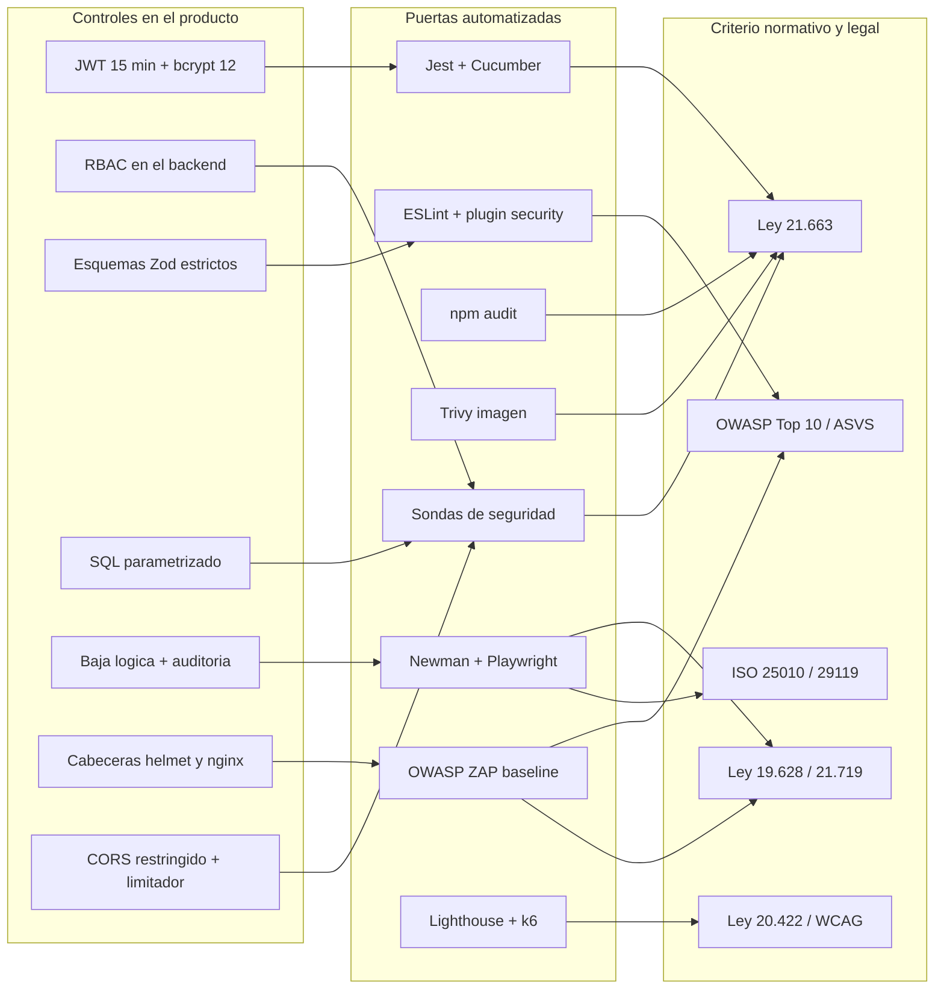

# Diagrama de controles de seguridad automatizados — Cuidarte+ v1.2

**Indicador IE3 (encargo, 14 %) e IE4 (defensa, 14 %).**
Figura para el informe: `evidencias/v1.2/capturas/diagrama_controles.png`
Se regenera con `node scripts/generar-diagrama.mjs`.

---

## 1. Qué representa el diagrama

El diagrama no es un dibujo del sistema: es un dibujo de **cómo se verifica el
sistema**. Recorre las cinco etapas por las que pasa el software desde que
alguien escribe una línea de código hasta que se autoriza su despliegue, y en
cada etapa muestra dos filas:

- **Control en el producto** — lo que el software hace para protegerse.
- **Puerta automatizada que lo verifica** — la herramienta que comprueba que ese
  control sigue existiendo y funcionando.

El color de la barra izquierda de cada caja indica **qué criterio normativo o
legal preserva**. Esa es la integración que exige el indicador: un control sin
verificación es una intención, y una verificación sin norma detrás es una
preferencia técnica.

```
  1 Código fuente  →  2 Dependencias  →  3 Imagen  →  4 Ambiente  →  5 Veredicto
  lo que se escribe   lo que se hereda   lo que se    lo que el      lo que se
                                         despliega    usuario recibe autoriza
```

---

## 2. Lectura etapa por etapa

### Etapa 1 — Código fuente: lo que se escribe

| Control en el producto | Puerta que lo verifica | Criterio |
|---|---|---|
| JWT de 15 minutos + bcrypt costo 12 | Jest (`password.test.js`), sondas SEG-A1/A4 | Ley 21.663 |
| RBAC aplicado en el **backend** | Jest `accesoYRoles`, sondas SEG-B1 a SEG-B7, Newman CP-API-16 a 20 | Ley 21.663 · RB-1 a RB-3 |
| Esquemas Zod `.strict()` | Sondas SEG-C9 (asignación masiva), SEG-C10 | OWASP A03 |
| Consultas SQL parametrizadas | Sondas SEG-C1 a SEG-C4 | OWASP A03 |
| Baja lógica + registro de auditoría | Jest, Playwright UI-05, Newman CP-API-14/26 | Ley 19.628 · RF-3.3, RF-5 |
| — | ESLint + `eslint-plugin-security` (SAST) | OWASP |
| — | ESLint `jsx-a11y` | Ley 20.422 |

**Lo que esta etapa no puede ver:** nada que dependa de la ejecución. Un
análisis estático no sabe qué cabeceras emite nginx ni qué responde el servidor
ante una petición inesperada.

### Etapa 2 — Dependencias: lo que se hereda

| Control | Puerta | Criterio |
|---|---|---|
| Versiones fijadas en `package.json` | `npm audit --omit=dev --audit-level=low` | Ley 21.663 |
| `package-lock.json` versionado | `npm audit --audit-level=high` | ISO/IEC 25010 |

**Dos umbrales deliberados.** En producción cualquier severidad bloquea, porque
ese código se despliega y corre con los privilegios de la aplicación. En
desarrollo solo bloquean alta y crítica, porque no se despliega, aunque sí se
ejecuta en el pipeline. La distinción no es laxitud: es que el riesgo es
distinto.

### Etapa 3 — Imagen de contenedor: lo que se despliega

| Control | Puerta | Criterio |
|---|---|---|
| Build multi-stage, sin código fuente ni toolchain | Trivy sobre la imagen | OWASP A05 |
| Usuario no privilegiado (uid 100) | `docker run --entrypoint id` | Ley 21.663 |
| `no-new-privileges` en compose | Revisión de `docker-compose.yml` | Ley 21.663 |

**Por qué esta etapa existe por separado.** Es la que detectó dos de los seis
hallazgos de esta EP3. Ni el análisis estático ni `npm audit` ven el sistema
operativo base ni las herramientas que la imagen arrastra: esa capa no la
escribió nadie del equipo, pero se despliega igual y su riesgo es del equipo.

### Etapa 4 — Ambiente en ejecución: lo que el usuario recibe

| Control | Puerta | Criterio |
|---|---|---|
| Cabeceras de seguridad de la API (helmet) | ZAP baseline sobre la API, sonda SEG-D3 | OWASP A05 |
| Cabeceras de seguridad en **toda** respuesta de nginx | ZAP baseline sobre la SPA, sondas SEG-D1/D2 | OWASP A05 |
| `Cache-Control: no-store` en datos clínicos | ZAP regla 10049, sonda SEG-D1 | Ley 19.628 |
| CORS restringido por origen | Sondas SEG-C7/C8 | OWASP A05 |
| Limitador por IP y bloqueo por cuenta | Sonda SEG-A6 | Ley 21.663 · NFR-SEG-11 |
| Flujo funcional completo | Playwright (7 casos) y Newman (26 peticiones) | ISO/IEC 29119 |
| Accesibilidad y rendimiento percibido | Lighthouse | Ley 20.422 · NFR-PERF |
| Concurrencia de 200 usuarios | k6 con los umbrales del ERS | ISO/IEC 25010 |

### Etapa 5 — Veredicto: lo que se autoriza

| Control | Puerta | Criterio |
|---|---|---|
| Trazabilidad caso → requisito | Cada anexo cita su caso y su requisito | ISO/IEC 29119 |
| Evidencia con fecha y ejecutor | Encabezado obligatorio en cada anexo | ISO/IEC 29119 |
| Registro de auditoría consultable | Newman CP-API-26 | Ley 19.628 · RF-5 |
| **Si una puerta falla, no se despliega** | Código de salida distinto de cero | ISO/IEC 25010 |
| **Hallazgo abierto → plan con plazo** | `04_Mitigacion_y_mantenimiento.md` | Ley 21.663 |

---

## 3. Los cinco criterios normativos y por qué aplican a este caso

| Criterio | Qué exige | Por qué aplica a Cuidarte+ |
|---|---|---|
| **Ley 19.628 / 21.719** sobre protección de datos personales | Los datos de salud son **dato sensible**: tratamiento con base legal, finalidad acotada, medidas de seguridad y derecho de acceso | Todo el sistema gira en torno a exámenes médicos de personas identificadas por RUT |
| **Ley 21.663** marco de ciberseguridad | Gestión de vulnerabilidades, control de acceso, registro de actividad y notificación de incidentes | Un prestador de salud es, en la práctica, servicio esencial |
| **Ley 20.422** sobre inclusión de personas con discapacidad | Accesibilidad de los medios electrónicos de atención | Pacientes consultan sus propios exámenes en la SPA |
| **OWASP Top 10 / ASVS** | Buenas prácticas de la industria | Es el marco al que se traza cada caso de prueba de seguridad |
| **ISO/IEC 25010 · ISO/IEC/IEEE 29119** | Modelo de calidad y proceso de pruebas | Sostiene la trazabilidad y la estructura de la evidencia |

> **Advertencia para la defensa.** No basta con nombrar las leyes. La pregunta
> típica es «¿cómo verificaron el cumplimiento?». La respuesta está en la
> segunda columna del diagrama: *el cumplimiento se verifica con la puerta
> automatizada, no con una declaración en el informe*. Por ejemplo: la ley
> 19.628 obliga a proteger el dato sensible; el control es
> `Cache-Control: no-store`; la puerta es la regla 10049 de OWASP ZAP; la
> evidencia es `zap-spa-DESPUES-consola.txt`.

---

## 4. El mismo diagrama en notación de flujo

Para quien prefiera leerlo como grafo:



---

## 5. Cómo explicarlo en 60 segundos (IE4)

> «El diagrama tiene cinco columnas, que son las cinco etapas por las que pasa
> el software: el código que escribimos, las librerías que heredamos, la imagen
> que se despliega, el ambiente en ejecución y el veredicto.
>
> En cada columna hay dos filas. Arriba, el control que protege el producto.
> Abajo, la herramienta automatizada que comprueba que ese control sigue ahí. El
> color dice qué ley o estándar preserva.
>
> La idea de fondo es que cada etapa ve algo que las otras no pueden ver. El
> análisis estático mira el código, pero no sabe qué cabeceras emite el
> servidor. `npm audit` mira las librerías declaradas, pero no ve el sistema
> operativo de la imagen. ZAP mira la aplicación encendida, pero no lee el
> código. En esta EP3, cuatro de los seis defectos que encontramos solo eran
> visibles desde una de esas capas, y ninguna prueba unitaria los habría
> detectado.»
