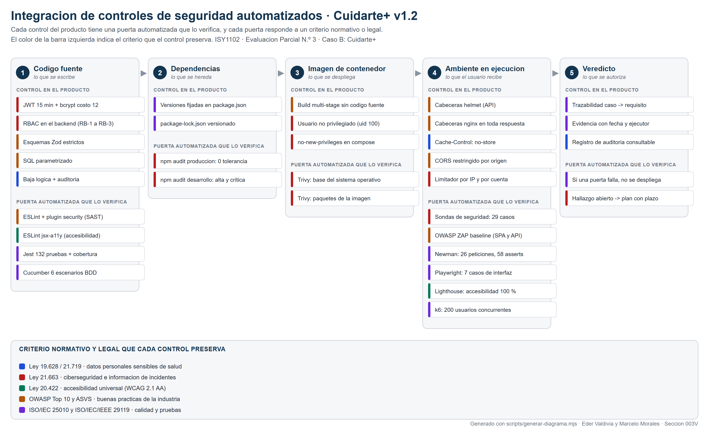

# Informe EP3 — Cuidarte+

**ISY1102 · Seguridad y Calidad en el Desarrollo de Software**
Evaluación Parcial N.º 3 · Caso B: Cuidarte+
Eder Valdivia · Marcelo Morales · Sección 003V
Docente: Mauricio Andrés Velásquez Silva · 23 de noviembre de 2026

---

## Índice

1. Puntos abordados en las evaluaciones previas, con sus ajustes
2. Resultados de la ejecución de pruebas de seguridad
3. Resultados de la ejecución de pruebas automatizadas
4. Propuestas de mitigación a los defectos identificados
5. Propuestas para preservar la calidad y el cumplimiento normativo y legal
6. Conclusiones
7. Anexos

---

## Resumen ejecutivo

Esta evaluación aplicó sobre Cuidarte+ v1.2 cinco enfoques de pruebas de
seguridad y cuatro herramientas de automatización que el proyecto no había
ejecutado nunca, pese a tener tres de ellas declaradas en su pipeline desde la
EP2. El resultado fue el hallazgo de **seis defectos reales**, cuatro de
criticidad grave, en un software que cerraba la EP2 con 132 pruebas verdes y
89,8 % de cobertura.

Los seis defectos fueron corregidos y verificados con la misma prueba que los
detectó. Las cifras consolidadas:

| Medida | Antes | Después |
|---|---|---|
| Sondas dirigidas de seguridad | 27 de 29 | **29 de 29** |
| OWASP ZAP sobre la SPA · fallos | 2 | **0** |
| OWASP ZAP sobre la SPA · reglas aprobadas | 64 | **67** |
| `npm audit` en dependencias de producción | 3 avisos (2 altas) | **0** |
| Trivy · imagen de la SPA | 239 (1 crítica, 57 altas) | **1 (0 altas)** |
| Trivy · imagen de la API | 33 (8 altas) | **11 (0 altas)** |
| Pruebas Jest y escenarios BDD | 132 de 132 · 6 de 6 | **132 de 132 · 6 de 6** |

La conclusión transversal del trabajo cabe en una frase: **un control declarado
no es un control ejecutado**. Los seis defectos existían desde octubre, estaban
dentro del alcance de herramientas que el propio proyecto había elegido, y
siguieron ahí porque nadie las corrió.

---

## 1. Puntos abordados en las evaluaciones previas, con sus ajustes

### 1.1 Qué se hereda de la EP1

La EP1 entregó la especificación de requisitos del Caso B y el plan de pruebas
inicial. La auditoría de la EP2 estableció que **nueve de los catorce
incidentes detectados tenían su origen en un vacío de especificación**: un
requisito que no se escribe no se implementa, no se prueba y termina siendo un
defecto. De esa constatación salió el documento de 23 requisitos adicionales
propuestos, del que esta EP3 toma los identificadores NFR-SEG-10 (cabeceras de
seguridad), NFR-SEG-11 (limitación de peticiones) y NFR-SEG-13 (gestión de
secretos), que se citan a lo largo de este informe como criterio de
verificación.

### 1.2 Qué se hereda de la EP2

| Resultado de la EP2 | Estado al cerrar | Tratamiento en la EP3 |
|---|---|---|
| 14 incidentes detectados en la v1.0 | Los 14 cerrados en la v1.1 | Regresión permanente |
| 34 casos de prueba · 45 de 45 requisitos cubiertos | 31 aprobados, 3 observados | Se amplía la cobertura, no se rehace |
| 132 pruebas Jest · 89,85 % de líneas | Verde | Regresión obligatoria |
| 6 escenarios BDD · 34 pasos | Verde | Regresión obligatoria |
| Pipeline de 9 etapas en GitHub Actions | 5 activas, 4 declaradas | **Se ejecutan las declaradas** |

### 1.3 Ajustes aplicados

No existe un documento escrito de retroalimentación del docente en el
repositorio de la EP2. Los ajustes que siguen se derivan de los casos observados
que la propia EP2 dejó anotados como pendientes y de lo que el encargo de la EP3
exige. Donde no hay retroalimentación documentada se indica así, en vez de
atribuir al docente una observación que no hizo.

**Ajuste 1 — Ejecutar las puertas que estaban solo declaradas.** El workflow
`calidad-y-seguridad.yml` define nueve etapas y ejecuta cinco. Las cuatro
restantes —SonarQube, Trivy y dos variantes de OWASP ZAP— quedaron como «diseño
de referencia» porque requieren servicios externos o un ambiente levantado. El
argumento es razonable para integración continua, pero su efecto quedó a la
vista en esta EP3: al ejecutarlas por primera vez aparecieron seis defectos
reales. Esas puertas ahora se ejecutan localmente con un comando y dejan
evidencia fechada.

**Ajuste 2 — Reconocer que la cobertura de código no es cobertura de riesgos.**
89,85 % de líneas cubiertas convivían con seis defectos de seguridad. Las
pruebas de la EP2 verifican el comportamiento del dominio; ninguna mira lo que
el servidor emite por la red, lo que la imagen de contenedor contiene, ni qué
ocurre ante una petición con una cabecera inesperada. Se agregaron tres capas de
verificación que no existían: sondas dirigidas, escaneo dinámico y escaneo de
imagen.

**Ajuste 3 — Evidencia comparable, no solo regenerable.** La EP2 ya generaba la
evidencia por script, lo que esta EP3 conserva. Se añade que cada anexo existe
en dos versiones, `-ANTES` y `-DESPUES`, porque la comparación entre ambas es la
prueba del impacto.

**Ajuste 4 — Cubrir los dos indicadores ausentes.** La EP2 no tenía diagrama de
controles ligado a normativa (14 %) ni plan de mantenimiento (20 %). Ambos se
desarrollan en las secciones 2.7 y 5 de este informe.

**Ajuste 5 — No afirmar lo que no se ejecutó.** SonarQube y JMeter siguen
definidos en el proyecto, pero **no se ejecutaron en esta iteración**. La prueba
de carga se hizo con k6. Declarar una herramienta que no se corrió es el error
más fácil de detectar en una defensa y el más caro.

### 1.4 De la versión 1.1 a la versión 1.2

| Cambio | Archivo | Incidente que resuelve |
|---|---|---|
| Rechazo de CORS controlado, sin error interno | `api/.../middleware/seguridad.js` | INC-EP3-02 |
| `Cache-Control: no-store` en toda respuesta de la API | `api/.../middleware/seguridad.js` | INC-EP3-05 |
| `Cross-Origin-Embedder-Policy` | `api/.../middleware/seguridad.js` | INC-EP3-05 |
| Cabeceras de seguridad en todo bloque `location` | `web/cabeceras-seguridad.conf` (nuevo) | INC-EP3-01 |
| Base de la imagen de la SPA actualizada | `web/Dockerfile` | INC-EP3-04 |
| `npm` eliminado de la imagen de producción | `api/Dockerfile` | INC-EP3-06 |
| `multer`, `body-parser` y `qs` actualizados | `api/package.json` | INC-EP3-03 |

---

## 2. Resultados de la ejecución de pruebas de seguridad

### 2.1 Enfoques aplicados y función de cada uno

Un enfoque de prueba no es una herramienta: la herramienta es el instrumento, el
enfoque es **qué clase de defecto puede encontrar**. Se aplicaron cinco, elegidos
porque cada uno ve algo que los demás no pueden ver por construcción.

| Enfoque | Herramienta | Función en la detección de vulnerabilidades | Lo que no puede ver |
|---|---|---|---|
| Análisis estático (SAST) | ESLint + `eslint-plugin-security` | Lee el código sin ejecutarlo y señala patrones inseguros: `eval`, concatenación de SQL, expresiones regulares susceptibles de denegación de servicio, `dangerouslySetInnerHTML` | El comportamiento en ejecución: no enciende la aplicación |
| Composición de software (SCA) | `npm audit` | Contrasta las librerías declaradas contra la base de avisos del registro npm | Todo lo que no figure en `package.json` |
| Composición de la imagen | Trivy | Escanea el artefacto desplegable: sistema operativo base, nginx, binarios y paquetes incluidos | El comportamiento de la aplicación |
| Análisis dinámico (DAST) | OWASP ZAP baseline | Recorre la aplicación encendida y examina lo que el servidor realmente envía: cabeceras, fugas de información, contenido cacheable | La lógica de negocio: no sabe quién debería poder ver qué |
| Pruebas dirigidas | Sondas propias (29 casos) | Casos negativos sobre las reglas de este sistema: inyección, XSS, CSRF, escalada de privilegios, referencias directas a objetos ajenos, control de acceso por rol y por titularidad | Vulnerabilidades genéricas que nadie previó al escribir el caso |

La última fila es la que justifica el conjunto: **ninguna herramienta genérica
sabe que en Cuidarte+ un paciente solo debe ver su propia ficha**. Esa regla es
RB-1 del ERS y su verificación hay que escribirla.

### 2.2 Cómo se ejecutaron

La batería completa se lanza con un comando sobre el ambiente levantado en
Docker:

```
cd ev3/seguridad
EJECUTOR="Nombre" bash ejecutar-seguridad.sh ANTES
```

Duración total: aproximadamente seis minutos, de los cuales cuatro corresponden
a los dos escaneos de ZAP. El orden no es arbitrario: las sondas se ejecutan al
final porque la sonda SEG-A6 agota deliberadamente la ventana del limitador de
autenticación, y cualquier prueba posterior recibiría HTTP 429.

### 2.3 Resultados por enfoque

**Análisis estático.** Cero hallazgos en la API y en la SPA, antes y después.
El código propio no presenta los patrones que estas reglas detectan. Esto es
relevante para interpretar el resto: los seis defectos encontrados **no están en
el código de la aplicación**, están en su configuración, en sus dependencias y
en su imagen.

**Dependencias.** La ejecución de octubre, en la EP2, daba cero. La de noviembre
dio tres avisos en dependencias de producción de la API: `body-parser` (alta),
`multer` (alta) y `qs` (moderada), los tres por denegación de servicio. El
código no cambió; cambió lo que se sabe de esas librerías. La SPA dio cero en
ambas ejecuciones.

**Imagen de contenedor.** El resultado más severo de toda la evaluación. La
imagen de la SPA arrojó **239 vulnerabilidades, una crítica y 57 altas**,
todas en bibliotecas del sistema base. La imagen de la API arrojó 33, repartidas
en dos capas distintas: 11 del sistema base, ninguna alta, y 22 en las librerías
que `npm` empaqueta consigo, de las cuales **ocho altas**. Ninguna proviene del
código propio, y ninguna es visible para los otros cuatro enfoques.

**Análisis dinámico.** Sobre la SPA: 2 reglas en estado FAIL, 2 en WARN y 64
aprobadas. Los dos fallos fueron la ausencia de `X-Content-Type-Options` y de
`Permissions-Policy` **en los archivos estáticos**, no en la página principal.
Sobre la API: 0 fallos, 1 aviso por contenido cacheable y 67 reglas aprobadas.

**Pruebas dirigidas.** 27 de 29 sondas aprobadas. Los dos fallos: la sonda
SEG-C7 detectó que una petición de origen ajeno recibía HTTP 500, y la sonda
SEG-D2 detectó, de forma independiente a ZAP, la ausencia de cabeceras en los
archivos estáticos.

| Enfoque de la sonda | Casos | Aprobados antes | Aprobados después |
|---|---|---|---|
| A · Autenticación y sesión | 6 | 6 | **6** |
| B · Control de acceso | 7 | 7 | **7** |
| C · Validación de entradas | 11 | 10 | **11** |
| D · Configuración y exposición | 5 | 4 | **5** |

### 2.4 Defectos identificados

| ID | Defecto | Criticidad | Enfoque que lo detectó |
|---|---|---|---|
| INC-EP3-01 | Los archivos estáticos de la SPA se servían sin ninguna cabecera de seguridad | Grave | Sonda SEG-D2 y OWASP ZAP (reglas 10021 y 10063) |
| INC-EP3-02 | Toda petición con cabecera `Origin` no permitida devolvía HTTP 500, incluido el healthcheck público | Grave | Sonda SEG-C7 |
| INC-EP3-03 | Tres dependencias de producción con avisos publicados después de la EP2 | Grave | `npm audit` |
| INC-EP3-04 | Imagen de la SPA sobre una base sin parches: 1 crítica y 57 altas | Grave | Trivy |
| INC-EP3-05 | Respuestas con datos clínicos almacenables en caché y sin aislamiento de origen cruzado | Moderado | OWASP ZAP (reglas 10049 y 90004) |
| INC-EP3-06 | La imagen de la API incluía `npm`, con 6 vulnerabilidades altas en sus librerías empaquetadas | Moderado | Trivy |

**El caso más instructivo es INC-EP3-01.** La configuración de nginx declaraba
las seis cabeceras de NFR-SEG-10 en el bloque `server` y se asumía que se
heredaban. En nginx no se heredan: en cuanto un bloque `location` declara su
propio `add_header`, **sustituye** por completo el conjunto del nivel superior.
Como el bloque de los archivos estáticos añadía su `Cache-Control`, todos los
`.js` y `.css` —es decir, la totalidad del código que el navegador ejecuta— se
servían sin `Content-Security-Policy`, sin `X-Frame-Options`, sin
`X-Content-Type-Options` y sin las demás. La configuración *parecía* correcta, y
por eso ninguna revisión de código lo había detectado: para verlo hay que pedir
el archivo y mirar la respuesta. Que lo detectaran por separado una sonda propia
y una herramienta de la industria es la mejor confirmación de que el hallazgo es
real y no un artefacto de la prueba.

**El caso más interesante desde el punto de vista metodológico es INC-EP3-06.**
La imagen base de Node incluye `npm`, y `npm` empaqueta sus propias copias de
`undici`, `brace-expansion` y otras librerías. `npm audit` no puede verlas,
porque no figuran en `package.json`: no son dependencias de la aplicación, son
herramientas del entorno de construcción que viajaron al artefacto desplegable.
Solo un escaneo de imagen las encuentra.

### 2.5 Interpretación de los códigos de salida

Dos herramientas devuelven códigos distintos de cero que **no son fallos de
ejecución**: `npm audit` devuelve 1 cuando encuentra avisos, y k6 devuelve 99
cuando algún umbral declarado no se cumple. En ambos casos el código es el
resultado de la prueba. De forma análoga, los HTTP 429 que aparecen en los
anexos corresponden al limitador de autenticación y al bloqueo por cuenta
(RF-1.3) funcionando como se diseñaron.

### 2.6 El registro de auditoría como evidencia de que los ataques no prosperaron

Un resultado colateral de la ejecución merece mención propia. La captura
`ui_05_auditoria-DESPUES.png`, tomada por la automatización de interfaz al
terminar la batería, muestra el registro de auditoría del sistema con las cargas
de inyección **almacenadas como texto plano** en la columna de detalle:

```
Intento de acceso fallido · Anonimo · intento con nombreUsuario="' OR '1'='1' --"
Intento de acceso fallido · Anonimo · intento con nombreUsuario="'; DROP TABLE usuario; --"
Intento de acceso fallido · Anonimo · intento con nombreUsuario="' UNION SELECT NULL,NULL,NULL --"
```

Que esas cadenas aparezcan en la tabla de auditoría, como dato y no como
instrucción ejecutada, es la demostración más directa de tres cosas a la vez:
las consultas están parametrizadas y la carga nunca llegó al motor de base de
datos; el sistema sigue operativo después del `DROP TABLE`, verificado por la
sonda SEG-C2; y el registro de auditoría cumple RF-5 dejando traza del intento,
que es precisamente lo que la ley 21.663 exige para poder reconstruir un
incidente.

La misma captura muestra los intentos sucesivos contra la cuenta señuelo
`sonda.bruta.*` que la sonda SEG-A6 crea para verificar el bloqueo por intentos
fallidos sin inutilizar a los usuarios de la semilla.

### 2.7 Diagrama de integración de los controles con el cumplimiento normativo

El diagrama siguiente representa cómo los controles automatizados se integran
con los criterios normativos y legales aplicables al caso.



Se lee en cinco columnas, que son las cinco etapas por las que pasa el software
desde que se escribe hasta que se autoriza su despliegue. Cada columna tiene dos
filas: arriba el **control en el producto**, abajo la **puerta automatizada que
lo verifica**. El color de la barra izquierda indica el criterio normativo que
ese control preserva.

| Etapa | Qué protege | Puertas que la verifican |
|---|---|---|
| 1 · Código fuente | JWT y bcrypt, RBAC en el backend, esquemas estrictos, SQL parametrizado, baja lógica y auditoría | ESLint con reglas de seguridad y de accesibilidad, Jest, Cucumber |
| 2 · Dependencias | Versiones fijadas y lock versionado | `npm audit` con dos umbrales: producción sin tolerancia, desarrollo solo alta y crítica |
| 3 · Imagen | Build multi-stage, usuario no privilegiado, `no-new-privileges` | Trivy sobre las dos imágenes, verificación del usuario de ejecución |
| 4 · Ambiente | Cabeceras de la API y de nginx, `no-store`, CORS restringido, limitadores | Sondas dirigidas, OWASP ZAP, Newman, Playwright, Lighthouse, k6 |
| 5 · Veredicto | Trazabilidad, evidencia fechada, auditoría consultable | Código de salida de cada puerta; hallazgo abierto obliga a plan con plazo |

**Los cinco criterios normativos y su aplicación a este caso:**

| Criterio | Qué exige | Por qué aplica a Cuidarte+ |
|---|---|---|
| Ley 19.628, actualizada por la 21.719 | Los datos de salud son dato sensible: base legal, finalidad acotada, medidas de seguridad y derecho de acceso | El sistema completo gira en torno a exámenes médicos de personas identificadas por RUT |
| Ley 21.663, marco de ciberseguridad | Gestión de vulnerabilidades, control de acceso, registro de actividad y notificación de incidentes | Un prestador de salud opera, en la práctica, un servicio esencial |
| Ley 20.422, sobre inclusión | Accesibilidad de los medios electrónicos de atención | Los propios pacientes consultan sus exámenes en la SPA |
| OWASP Top 10 y ASVS | Buenas prácticas de la industria | Es el marco al que se traza cada caso de prueba de seguridad |
| ISO/IEC 25010 e ISO/IEC/IEEE 29119 | Modelo de calidad del producto y proceso de pruebas | Sostiene la trazabilidad y la estructura de la evidencia |

La integración consiste precisamente en esto: **el cumplimiento no se declara,
se verifica con una puerta que deja registro**. Un ejemplo completo: la ley
19.628 obliga a proteger el dato sensible; el control es `Cache-Control:
no-store`, para que una ficha clínica no quede en la caché del navegador tras
cerrar sesión; la puerta es la regla 10049 de OWASP ZAP; la evidencia es el
archivo `zap-spa-DESPUES-consola.txt`, con su fecha y su ejecutor.

---

## 3. Resultados de la ejecución de pruebas automatizadas

### 3.1 Herramientas incorporadas en esta iteración

La EP2 tenía automatizadas las pruebas unitarias, de integración y de
comportamiento. La EP3 incorpora cuatro herramientas que no existían en el
proyecto, cada una para una capa que ninguna de las anteriores alcanzaba.

| Tipo de prueba | Herramienta | Qué automatiza | Por qué esta herramienta |
|---|---|---|---|
| Funcional de interfaz | Playwright | El recorrido completo del usuario en un navegador real | Es la que la guía sugiere junto a Cypress; ejecuta sin interfaz gráfica y no requiere servidor de pruebas |
| Funcional de servicios | Postman + Newman | Los endpoints de la API y la forma de sus respuestas | La colección es el formato estándar para documentar y compartir pruebas de API; Newman la ejecuta en consola |
| No funcional | Lighthouse | Rendimiento percibido, accesibilidad y buenas prácticas sobre la pantalla real | Convierte los criterios de la ley 20.422 en una puerta con umbral |
| No funcional de carga | k6 | Concurrencia de 200 usuarios con los umbrales del ERS | Los umbrales se declaran como `thresholds`: la prueba falla sola si se incumplen |

A ellas se suman, como regresión, las 132 pruebas Jest y los 6 escenarios
Cucumber heredados de la EP2.

### 3.2 Casos diseñados y su trazabilidad

**Interfaz de usuario (Playwright), 7 casos:**

| ID | Requisito | Caso |
|---|---|---|
| UI-01 | RF-1.1 | Inicio de sesión del administrador |
| UI-02 | RF-2.2 | Listado de pacientes y filtro de búsqueda |
| UI-03 | RF-4.1 | Flujo escalonado paciente → exámenes (NFR-USAB-4) |
| UI-04 | RF-3.1 | Registro de un examen nuevo desde la interfaz |
| UI-05 | RF-5 | El registro de auditoría contiene la acción recién ejecutada |
| UI-06 | NFR-SEG-4 | El rol PACIENTE no ve el menú de auditoría y solo accede a su ficha |
| UI-07 | RF-1.2 | El cierre de sesión devuelve a la pantalla de acceso |

**API REST (Postman + Newman), 26 peticiones y 58 aserciones**, organizadas en
seis carpetas: disponibilidad (NFR-DIS-1), autenticación (RF-1.1, RF-1.3),
pacientes (RF-2.2 a RF-2.4), exámenes (RF-3.1 a RF-3.3), control de acceso
(NFR-SEG-4, RB-1 a RB-3) y validación de entradas (NFR-SEG-5), más la auditoría
(RF-5).

La colección incluye **casos negativos**, que son los que más valor aportan: RUT
con dígito verificador incorrecto, campo no declarado en el cuerpo, intento de
elegir el rol al registrarse, carga de inyección SQL en el formulario de acceso
e identificador de ruta no numérico. Todos deben devolver 400 o 403; si alguno
devolviera 200, la colección falla.

### 3.3 Resultados obtenidos

| Prueba | Alcance | Resultado | Duración |
|---|---|---|---|
| Jest | 132 pruebas, 6 suites | 132 de 132 · 89,85 % de líneas | ~25 s |
| Cucumber | 6 escenarios, 34 pasos | 6 de 6 · 34 de 34 | ~14 s |
| Newman | 26 peticiones, 58 aserciones | 58 de 58 · 0 fallos | **4,3 s** |
| Playwright | 7 casos | 7 de 7 · 0 errores de consola | **8,4 s** |
| Lighthouse | 4 categorías | Rendimiento 100 · Accesibilidad 100 · Buenas prácticas 100 · SEO 91 | 15,4 s |
| k6 | 200 usuarios, 45 s | 7.414 iteraciones · 0,00 % de error | 46,0 s |

**Umbrales del ERS verificados por k6:**

| Escenario | Requisito | Umbral | Medido | Veredicto |
|---|---|---|---|---|
| Exámenes de un paciente | NFR-PERF-1 | p95 ≤ 300 ms | 127 ms | CUMPLE |
| Listado de pacientes | NFR-PERF-2 | p95 ≤ 2000 ms | 84 ms | CUMPLE |
| Healthcheck | NFR-DIS-3 | p95 ≤ 300 ms | 44 ms | CUMPLE |
| Concurrencia | NFR-PERF-3 | 200 usuarios | 200 | CUMPLE |
| Tasa de error | NFR-DIS-1 | < 1 % | 0,00 % | CUMPLE |

Comparado con la medición de la EP2 del 12 de octubre, el escenario de exámenes
pasó de p95 = 222 ms a 127 ms y el listado de 265 ms a 84 ms. La mejora no
responde a una optimización deliberada: es el efecto secundario de actualizar
las dependencias y la imagen base.

La carga se dimensionó en **una petición por segundo por usuario virtual**, que
con 200 usuarios da 12.000 peticiones por minuto. Ese es exactamente el supuesto
con el que se dimensionó el limitador general por IP (15.000). Una carga mayor
habría medido el limitador en lugar del rendimiento de la aplicación, y los HTTP
429 resultantes se habrían confundido con fallos.

### 3.4 Impacto en el uso de tiempo y recursos

| Prueba | Ejecución automatizada | Equivalente manual estimado | Reducción |
|---|---|---|---|
| 7 casos de interfaz | 8,4 s | ~10,5 min (90 s por caso) | 98,7 % |
| 58 aserciones de API | 4,3 s | ~29 min (30 s por aserción) | 99,8 % |
| 17 criterios de accesibilidad | 15,4 s | 2 a 3 horas de revisión manual | 99,8 % |
| 7.414 peticiones con 200 usuarios | 46,0 s | No reproducible manualmente | — |

La batería funcional completa —regresión, API, interfaz, no funcional y carga—
corre en **menos de tres minutos**. Ejecutar a mano el mismo conjunto de
comprobaciones ocupa a una persona varias horas, y esa es precisamente la razón
por la que no se hace.

El argumento de fondo no es el ahorro de tiempo sino la **frecuencia**: una
prueba manual de diez minutos se ejecuta una vez y se abandona; una de nueve
segundos se ejecuta en cada cambio. La automatización no sustituye al tiempo
humano, cambia el momento en que se detecta el defecto. INC-EP3-03 lo ilustra:
dos vulnerabilidades altas aparecieron en dependencias **sin que el código
cambiara**, y solo una ejecución periódica podía encontrarlas.

Un efecto secundario relevante para el uso de recursos: las pruebas corren sobre
el mismo ambiente Docker del desarrollo, sin infraestructura adicional. Las
únicas descargas son las imágenes de ZAP, Trivy y k6, que quedan en caché local.

---

## 4. Propuestas de mitigación a los defectos identificados

### 4.1 Mitigación aplicada por defecto

**INC-EP3-01 · Cabeceras ausentes en los archivos estáticos.**
*Mitigación:* las seis cabeceras se extrajeron a un fragmento único,
`web/cabeceras-seguridad.conf`, que se incluye explícitamente en cada bloque
`location`. La herencia dejó de ser un supuesto y pasó a ser una declaración
verificable. *Verificación:* la sonda SEG-D2 pasa a APRUEBA y ZAP pasa de 2
FAIL-NEW a 0, con 67 reglas aprobadas en lugar de 64.

**INC-EP3-02 · Error interno ante un origen no permitido.**
*Mitigación:* el rechazo de CORS pasó de `callback(new Error(...))` —que
escalaba al manejador de errores y producía un 500— a `callback(null, false)`.
La petición sigue su curso sin emitir cabeceras `Access-Control-Allow-*`, el
navegador bloquea la lectura de la respuesta, que es lo que CORS debe hacer, y
la petición recibe el código que le corresponde por sus propios controles.
*Verificación:* `GET /salud` con origen ajeno pasa de 500 a 200;
`POST /pacientes` sin token con origen ajeno pasa de 500 a 401.

**INC-EP3-03 · Dependencias con avisos nuevos.**
*Mitigación:* `multer` actualizado de 2.4.0 a 2.5.0 y actualización de las
transitivas `body-parser` y `qs`. *Verificación:* `npm audit --omit=dev` pasa de
3 avisos a 0 vulnerabilidades, en la API y en la SPA.

**INC-EP3-04 · Base de la imagen de la SPA sin parches.**
*Mitigación:* base actualizada de `nginx:1.29-alpine` (Alpine 3.23.4) a
`nginx:1.31-alpine` (Alpine 3.24.4). *Verificación:* la imagen pasa de 239
vulnerabilidades, una crítica y 57 altas, a **una sola de severidad media**.

**INC-EP3-05 · Caché de datos clínicos y aislamiento de origen.**
*Mitigación:* `Cache-Control: no-store` en toda respuesta de la API y en el
documento HTML de la SPA; `Cross-Origin-Embedder-Policy: credentialless` y
`Cross-Origin-Opener-Policy: same-origin`. Los archivos con hash en el nombre
conservan caché larga, porque no exponen ningún dato. *Verificación:* la regla
10049 de ZAP pasa de «Storable and Cacheable Content» a «Non-Storable Content»,
y la 90004 pasa a estado PASS.

**INC-EP3-06 · El gestor de paquetes viajaba a producción.**
*Mitigación:* la imagen de ejecución elimina `npm`, `npx` y `yarn`. La
aplicación no los necesita: arranca con `node src/server.js` y su healthcheck
usa `node -e`; las dependencias vienen instaladas desde la etapa anterior del
build multi-stage. *Verificación:* la sección «Node.js (node-pkg)» desaparece
del informe de Trivy, con lo que se eliminan 19 hallazgos, 6 de ellos altos.

### 4.2 Resultado consolidado

| Medida | Antes | Después |
|---|---|---|
| Sondas de seguridad aprobadas | 27 de 29 | **29 de 29** |
| OWASP ZAP sobre la SPA · FAIL-NEW | 2 | **0** |
| OWASP ZAP sobre la SPA · reglas aprobadas | 64 | **67** |
| OWASP ZAP sobre la API · FAIL-NEW | 0 | **0** |
| `npm audit` producción (API) | 3 avisos (2 altas) | **0** |
| Trivy · imagen de la SPA | 239 (1 crítica, 57 altas) | **1 (0 altas)** |
| Trivy · imagen de la API | 33 (8 altas) | **11 (0 altas)** |
| Pruebas Jest | 132 de 132 | **132 de 132** |
| Escenarios BDD | 6 de 6 | **6 de 6** |

Ninguna corrección rompió nada: la regresión heredada de la EP2 sigue completa.
Esa es la razón de ejecutarla **después** de cada cambio y no solo antes.

### 4.3 Criterio de priorización

Los defectos se priorizaron combinando dos criterios: **alcance**, es decir a
cuántas respuestas o componentes afecta, y **explotabilidad**, es decir qué
necesita un atacante para aprovecharlo.

| Orden | Defecto | Alcance | Explotabilidad |
|---|---|---|---|
| 1 | INC-EP3-01 | 100 % del código que ejecuta el navegador | No requiere nada: basta pedir el archivo |
| 2 | INC-EP3-02 | Todos los endpoints, incluido el público | Basta enviar una cabecera |
| 3 | INC-EP3-04 | Toda la imagen de la pantalla | Depende de la explotación de cada CVE |
| 4 | INC-EP3-03 | Dos librerías de producción | Denegación de servicio con petición manipulada |
| 5 | INC-EP3-06 | Imagen de la API | Requiere ejecución previa en el contenedor |
| 6 | INC-EP3-05 | Respuestas con datos clínicos | Requiere acceso físico o a la caché |

---

## 5. Propuestas para preservar la calidad y el cumplimiento normativo y legal

### 5.1 Plan de mantenimiento

El plan responde cuatro preguntas por cada actividad: **cuándo, quién, qué se
re-ejecuta y qué evidencia deja**.

| Frecuencia | Actividad | Responsable | Evidencia | Criterio que preserva |
|---|---|---|---|---|
| Cada cambio de código | `npm run verify` en la API: formato, ESLint, Jest con cobertura, BDD y `npm audit` | Quien integra el cambio | Salida del pipeline | ISO/IEC 25010 · NFR-CAL-1 a 5 |
| Cada cambio de interfaz | Playwright y Lighthouse | Responsable de frontend | Anexos A1 y A3 | Ley 20.422 · NFR-USAB |
| Cada cambio de API | Colección Postman con Newman | Responsable de backend | Anexo A2 | ISO/IEC 29119 |
| Semanal | `npm audit` en API y SPA, aunque no haya cambios | Rol de seguridad | Anexo S2 fechado | Ley 21.663 |
| Cada candidato a release | Batería de seguridad completa: sondas, Trivy, ZAP y SAST | Rol de seguridad | Carpeta de evidencias de la versión | Ley 21.663 · OWASP |
| Cada candidato a release | k6 con 200 usuarios y comparación con los umbrales del ERS | Rol de rendimiento | Anexo A4 | NFR-PERF-1/2/3 |
| Mensual | Reconstrucción de las imágenes base y nuevo escaneo | Rol de despliegue | Anexo S3 fechado | Ley 21.663 |
| Trimestral | Revisión de hallazgos abiertos y de la normativa aplicable | Equipo completo | Acta breve | Ley 19.628 / 21.719 |
| Antes de salir de localhost | HTTPS obligatorio, rotación de secretos, revisión de `CORS_ORIGENES` | Rol de despliegue | Lista de verificación de despliegue | NFR-SEG-1 · NFR-SEG-13 |

La actividad **semanal** es la más difícil de justificar ante quien no ha visto
estos resultados, y la más importante. INC-EP3-03 demuestra por qué: el código
no había cambiado en un mes y, aun así, aparecieron dos vulnerabilidades altas
en dependencias de producción. Un plan que solo verifique «cuando se toca el
código» no las habría visto.

### 5.2 Mejora continua: incorporar al pipeline las puertas que faltan

La EP2 dejó cinco de las nueve etapas activas. La propuesta concreta es
incorporar las restantes por orden de valor respecto del esfuerzo:

| Prioridad | Etapa | Qué hace falta | Qué habría evitado |
|---|---|---|---|
| 1 | Trivy sobre las dos imágenes | Nada: se ejecuta en el propio runner | INC-EP3-04 e INC-EP3-06 |
| 2 | OWASP ZAP baseline | Levantar `docker compose` en el runner | INC-EP3-01 e INC-EP3-05 |
| 3 | Sondas dirigidas | Lo mismo que ZAP | INC-EP3-02 |
| 4 | SonarQube | Servidor y token de servicio | Deuda técnica; el de menor urgencia |

Las tres primeras no requieren servicios externos y cubren **cinco de los seis
hallazgos** de esta evaluación.

**Esta propuesta quedó implementada.** El archivo
`.github/workflows/calidad-y-seguridad-ep3.yml` ejecuta las tres puertas en cada
cambio, organizado en las mismas cinco etapas del diagrama de la sección 2.7: un
trabajo por etapa, cada uno con las puertas que le corresponden, y un trabajo
final que consolida el veredicto vinculando cada puerta con el criterio
normativo que preserva. El trabajo de ambiente levanta la aplicación completa en
el runner, carga la semilla y le aplica las sondas, la colección de Postman y
los dos escaneos de ZAP; el de imágenes construye los dos contenedores, los
escanea con Trivy y verifica además que la API no corra como root y que la
imagen no incluya `npm`, de modo que una reversión de la corrección de
INC-EP3-06 detenga el pipeline.

Lighthouse y k6 **no** se incorporaron, por una razón que conviene explicitar:
sus umbrales miden rendimiento percibido, y en un runner compartido la cifra
depende de la máquina que toque, de modo que deja de ser comparable entre
ejecuciones. Siguen como actividad de ambiente local dentro del plan. Declarar
en el pipeline una medición cuyo umbral no se puede sostener sería repetir
exactamente el error que esta evaluación corrige.

### 5.3 Criterio de salida a producción

El software no se autoriza mientras exista alguna de estas condiciones:

1. Una puerta automatizada en rojo sin excepción documentada y con plazo.
2. Una vulnerabilidad crítica o alta en dependencias de producción o en las
   imágenes de contenedor.
3. Un hallazgo de ZAP clasificado como FAIL según `.zap/rules.tsv`, cuyas reglas
   están trazadas a requisitos del ERS.
4. Cobertura de líneas por debajo del umbral declarado en `jest.config.js`.
5. Exposición fuera de `localhost` sin TLS, sin secretos rotados y sin revisión
   de los orígenes CORS permitidos.

**Estado de la versión 1.2:** las cinco condiciones se cumplen. Los seis
defectos detectados están cerrados y verificados. Queda abierta, como deuda
conocida y documentada, la exposición sin TLS, que es una decisión de ambiente y
no de software: el ambiente de QA corre en `localhost`.

### 5.4 Preservación del cumplimiento normativo y legal

| Norma | Obligación | Control implementado | Puerta que lo verifica |
|---|---|---|---|
| Ley 19.628 / 21.719 | Proteger el dato sensible de salud | Cifrado de contraseñas con bcrypt costo 12, baja lógica con auditoría, `Cache-Control: no-store`, datos de QA ficticios | Jest, Newman CP-API-26, ZAP regla 10049 |
| Ley 19.628 / 21.719 | Trazabilidad del tratamiento | Registro de auditoría consultable solo por administrador | Playwright UI-05, Newman CP-API-16 y 26 |
| Ley 21.663 | Gestión de vulnerabilidades | `npm audit` y Trivy con umbrales declarados | Anexos S2 y S3, semanal y mensual |
| Ley 21.663 | Control de acceso | RBAC aplicado en el backend, no en la interfaz | Sondas SEG-B1 a SEG-B7, Newman CP-API-16 a 20 |
| Ley 21.663 | Protección ante abuso automatizado | Limitador por IP y bloqueo por cuenta | Sonda SEG-A6 |
| Ley 20.422 | Accesibilidad de los medios electrónicos | Etiquetas asociadas, `aria-invalid`, contraste y anuncio de mensajes | ESLint `jsx-a11y` y Lighthouse con umbral de 90 % |
| OWASP Top 10 | Buenas prácticas de la industria | Cabeceras, esquemas estrictos, SQL parametrizado | ZAP, sondas de los enfoques C y D |

### 5.5 Lo que no se automatiza, y por qué

| Actividad | Razón |
|---|---|
| Revisión de accesibilidad con lector de pantalla | Lighthouse verifica 17 criterios automatizables; WCAG 2.1 AA tiene más de 50, y los restantes exigen juicio humano |
| Revisión de la base legal del tratamiento de datos | Ninguna herramienta decide si una finalidad es legítima |
| Modelo de amenazas ante un requisito nuevo | Es un ejercicio de diseño, no de verificación |
| Validación de que los datos de QA no son datos reales | Es un control de proceso: la ley 19.628 lo exige y la semilla lo documenta |

Declarar qué **no** cubre la automatización es parte del plan. Un plan que
afirme cubrirlo todo describe un sistema que no existe.

---

## 6. Conclusiones

**Sobre la calidad.** 89,85 % de cobertura y 132 pruebas verdes convivían con
seis defectos de seguridad, cuatro de ellos graves. No es una falla de esa
batería: verifica el comportamiento del dominio, y estos defectos viven en la
configuración del servidor, en las dependencias y en la imagen de contenedor.
La cobertura mide líneas ejecutadas, no riesgos cubiertos, y confundir ambas
cosas es lo que mantuvo estos defectos invisibles durante un mes.

**Sobre los enfoques de prueba.** Cada uno de los cinco enfoques aplicados
detectó algo que los otros cuatro no podían ver. El análisis estático no
encuentra nada en el código propio, lo que a primera vista parece un resultado
vacío y en realidad es información: señala que el problema está en otra capa.
`npm audit` no ve lo que no se declara. Trivy no ve el comportamiento. ZAP no
conoce las reglas de negocio. Las sondas propias no encuentran lo que nadie
previó. La cobertura real surge de la **combinación**, no de elegir bien una
herramienta.

**Sobre la automatización.** Su valor no está en el tiempo que ahorra, sino en
que convierte una verificación ocasional en una verificación sistemática. Los
seis defectos de esta evaluación no requerían herramientas nuevas: tres de ellas
ya estaban elegidas y escritas en el pipeline de la EP2. Lo que faltaba era
ejecutarlas. De ahí la frase que resume el trabajo: **un control declarado no es
un control ejecutado.**

**Sobre seguridad y normativa.** Cuidarte+ trata datos de salud, que la ley
19.628 define como dato sensible. Eso eleva el estándar exigible: no basta con
que el sistema funcione, tiene que poder **demostrar** que protege. El diagrama
de la sección 2.7 es la forma concreta de esa demostración, porque cada norma
aparece unida a un control y cada control a una puerta que deja evidencia
fechada y reproducible.

**Veredicto.** La versión 1.2 de Cuidarte+ cierra los seis defectos detectados,
verificados con la misma prueba que los encontró, y cumple las cinco condiciones
del criterio de salida definido en la sección 5.3. Está en condiciones de
avanzar a un ambiente productivo con riesgo controlado, una vez atendidos los
puntos de despliegue que el plan de mantenimiento identifica como deuda
conocida: TLS, rotación de secretos y revisión de los orígenes permitidos.

---

## 7. Anexos

Toda la evidencia citada en este informe está en `ev3/evidencias/v1.2/` y se
regenera con los comandos de `docs/07_Paso_a_Paso_Reproducir_EP3.md`. Cada anexo
lleva encabezado con fecha de ejecución, ejecutor, herramienta y versión bajo
prueba.

### Anexos de seguridad

| Anexo | Archivo | Contenido |
|---|---|---|
| S1 | `seguridad/Anexo_S1_sondas-seguridad-{ANTES,DESPUES}.txt` | 29 sondas dirigidas en cuatro enfoques |
| S2 | `seguridad/Anexo_S2_npm-audit-{ANTES,DESPUES}.txt` | Análisis de dependencias de API y SPA |
| S3 | `seguridad/Anexo_S3_trivy-imagenes-{ANTES,DESPUES}.txt` | Escaneo de las dos imágenes de contenedor |
| S4 | `seguridad/Anexo_S4_sast-eslint-{ANTES,DESPUES}.txt` | Análisis estático y consistencia de formato |
| S5 | `seguridad/zap/zap-spa-{ANTES,DESPUES}.html` | Informe de OWASP ZAP sobre la SPA |
| S6 | `seguridad/zap/zap-api-{ANTES,DESPUES}.html` | Informe de OWASP ZAP sobre la API |

### Anexos de automatización

| Anexo | Archivo | Contenido |
|---|---|---|
| A0 | `automatizacion/Anexo_A0_jest-y-bdd-DESPUES.txt` | Jest con cobertura y escenarios Cucumber |
| A1 | `automatizacion/Anexo_A1_playwright-ui-{ANTES,DESPUES}.txt` | Siete casos de interfaz |
| A2 | `automatizacion/Anexo_A2_newman-api-{ANTES,DESPUES}.txt` | 26 peticiones y 58 aserciones |
| A3 | `automatizacion/Anexo_A3_lighthouse-{ANTES,DESPUES}.txt` | Rendimiento y accesibilidad |
| A4 | `automatizacion/Anexo_A4_k6-carga-{ANTES,DESPUES}.txt` | Carga con 200 usuarios concurrentes |

### Figuras

| Figura | Archivo |
|---|---|
| Diagrama de controles de seguridad automatizados | `capturas/diagrama_controles.png` |
| Capturas del recorrido automatizado de interfaz | `capturas/ui_01` a `ui_06` |

### Documentación complementaria

| Documento | Contenido |
|---|---|
| `docs/00_Comparacion_EV2_y_ejemplo_Atlas.md` | Análisis de brechas que originó este trabajo |
| `docs/01_Plan_de_pasos_EP3.md` | Plan de trabajo ordenado por la rúbrica |
| `docs/02_Ajustes_EP1_EP2.md` | Detalle de los ajustes de la sección 1 |
| `docs/03_Diagrama_controles.md` | Lectura ampliada del diagrama |
| `docs/04_Mitigacion_y_mantenimiento.md` | Detalle de las secciones 4 y 5 |
| `docs/05_Guion_Oral_EP3.md` | Guion de la defensa y banco de preguntas |
| `docs/07_Paso_a_Paso_Reproducir_EP3.md` | Cómo reproducir cada cifra de este informe |
| `evidencias/v1.2/RESULTADOS_EP3.md` | Consolidado de todas las ejecuciones |
